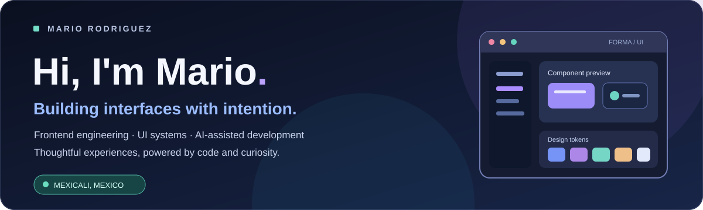
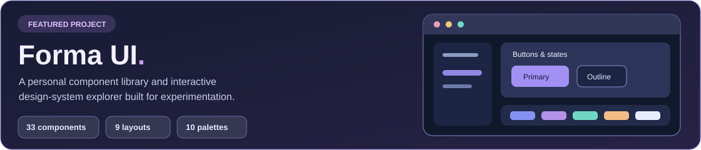

<!-- GitHub profile README for @rgzrgzm -->

  
  

    <a href="https://rgzrgzm-dev.netlify.app/">Portfolio</a>
    &nbsp;·&nbsp;
    <a href="https://github.com/rgzrgzm/forma-ui">Forma UI</a>
    &nbsp;·&nbsp;
    <a href="https://linkedin.com/in/rgzrgzm">LinkedIn</a>
    &nbsp;·&nbsp;
    <a href="mailto:rgzrgzm@gmail.com">Email</a>
  

## A little about me

I'm **Mario**, a software developer based in **Mexicali, Mexico**. I enjoy taking ideas from the first sketch to a polished, working interface — combining **frontend engineering, thoughtful UX, and maintainable code**.

My work spans **React, Next.js, and TypeScript** on the frontend, as well as **Node.js, Express, and APIs** behind the scenes. I'm especially interested in **design systems**, reusable components, responsive layouts, and the small interactions that make software feel great.

> I like building things that are useful, intuitive, and enjoyable to use.

## Featured project — Forma UI

**[Explore Forma UI →](https://github.com/rgzrgzm/forma-ui)**

What started as a personal component library became a standalone, interactive design-system playground. It brings UI foundations, reusable components, responsive layouts, and copyable examples together in one place.

- **33** interactive component entries with variants and states
- **9** interface recipes and layouts
- **10** color palettes, with light and dark themes
- Copyable **HTML, CSS, and JavaScript** examples
- Keyboard interactions, responsive behavior, and documented QA checks

**Another project:** [Soccerbase](https://github.com/rgzrgzm/soccerbase-app) — a web app using **Next.js** and **TypeScript**. [Live project](https://soccerbase.netlify.app/).

## Technologies & expertise

The technologies, tools, and practices behind my work.

### Frontend engineering
`TypeScript` · `React` · `Next.js` · `JavaScript` · `Tailwind CSS` · `HTML5` · `CSS3`

### Backend & data
`Node.js` · `Express` · `REST APIs` · `PostgreSQL` · `MongoDB` · `Supabase`

### UI/UX & design systems
`Figma` · `Design Systems` · `Component Architecture` · `Responsive Design` · `Accessibility` · `Prototyping`

### AI & developer tools
`OpenAI Codex` · `ChatGPT` · `Git` · `GitHub` · `Postman` · `VS Code`

<strong>Additional experience</strong>

 

`React Native` · `Redux` · `Bootstrap` · `Sequelize` · `WebSockets`

## How I work with AI

I use **ChatGPT, OpenAI Codex, and other AI-assisted tools** as a practical part of my development workflow — not as a replacement for understanding the code, but as a way to explore ideas, solve problems, and iterate faster.

| Where AI helps | How I use it |
| --- | --- |
| **UI ideation** | Explore layouts, component variants, and interaction patterns. |
| **Prototyping** | Turn ideas and visual references into an initial implementation. |
| **Development** | Work through implementation options, debugging, and refactoring. |
| **Quality & documentation** | Draft test ideas, improve UX copy, and make documentation easier to follow. |

I still care about **reviewing the output, understanding the tradeoffs, and validating the final experience**.

## Beyond the editor

I enjoy learning new tools, building side projects just to try an idea, and appreciating the details in great design. Usually fueled by **black coffee** — and always happy to unwind with a good video game. ☕🎮

## Let's connect

I'm interested in connecting with people who care about **frontend engineering, thoughtful interfaces, and useful software**.

**[Portfolio](https://rgzrgzm-dev.netlify.app/)** · **[LinkedIn](https://linkedin.com/in/rgzrgzm)** · **[Email me](mailto:rgzrgzm@gmail.com)** · **[GitHub](https://github.com/rgzrgzm)**
